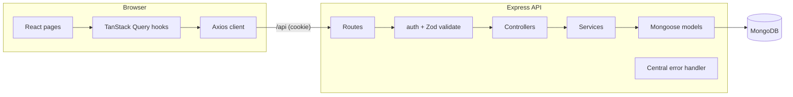

# OfferTrail

> Track every job application on a Kanban board, never miss a follow-up, and see which channels actually get you interviews.

[](https://github.com/Sarthak261-rgb/offertrail/actions/workflows/ci.yml)

**Demo login** (after `npm run seed`): `demo@offertrail.dev` / `demo1234`. The login page has a "Fill in demo account" button.

---

## Why I built this

A job search with 30+ open applications quickly outgrows a spreadsheet: you forget who to follow up with, lose track of where each application stands, and can't tell whether referrals or LinkedIn work better for you. OfferTrail solves those three problems: a board for where things stand, reminders for follow-ups, and stats for what's working.

## Features

- 🔐 **Secure authentication**: JWT in an `httpOnly` cookie (never in `localStorage`), bcrypt password hashing, rate-limited auth routes
- 🛡️ **Per-user data isolation**: every query is scoped to the logged-in user, and another user's record returns 404. Both are covered by tests
- 🗂️ **Kanban board**: drag applications through Wishlist → Applied → Interview → Offer → Rejected. Updates are optimistic and roll back with a toast if the server rejects them. Drag and drop also works with a keyboard
- 🕒 **Automatic status timeline**: the server records every status change, so the history can't be edited from the client
- 🔔 **Follow-up reminders**: a panel of open applications whose follow-up date is today or overdue
- 🔎 **List view**: case-insensitive search, filters by status, source and priority, sorting and pagination, all kept in the URL so a filtered view survives a refresh and can be shared
- 📊 **Stats dashboard**: interview rate, applications per week and interview rate by source, computed in a single MongoDB `$facet` aggregation
- ✅ **Validation on both sides**: Zod schemas on the API (strict, so unknown fields like `user` are rejected) and matching checks in the form, with server errors mapped back to the right fields
- 📱 **Responsive**: works down to 375 px. Loading, error and empty states on every screen
- 🌱 **One-command demo data**: `npm run seed`

## Tech Stack

| Layer    | Technology                                                                                             |
| -------- | ------------------------------------------------------------------------------------------------------ |
| Database | MongoDB (Atlas), Mongoose 8                                                                            |
| Backend  | Node.js 20, Express 5, Zod, jsonwebtoken, bcryptjs, helmet, express-rate-limit, cookie-parser          |
| Frontend | React 18, Vite 6, React Router 6, TanStack Query 5, Tailwind CSS 4, dnd-kit, Recharts, react-hot-toast |
| Testing  | Vitest, Supertest, mongodb-memory-server, React Testing Library                                        |
| Tooling  | npm workspaces, ESLint 9, Prettier, GitHub Actions CI, Render Blueprint                                |
| AI tool  | Claude Code                                                                                            |

## Architecture



- **Layered backend**: routes only wire middleware, controllers handle HTTP, and services hold the business logic and all database access. Every error ends up in one error handler, which returns a consistent `{ error: { message, details } }` shape.
- **One deployable service**: in production, Express also serves the built React app. The browser and API share an origin, which avoids cross-site cookie and CORS problems.

### Design decisions

| Decision                                                | Why                                                                                                                                                                        |
| ------------------------------------------------------- | -------------------------------------------------------------------------------------------------------------------------------------------------------------------------- |
| `statusHistory` embedded in the application document    | It's always read together with the application, it's bounded (a handful of entries), and it makes the stats aggregation a single-collection query                          |
| Status history written in a Mongoose `pre('save')` hook | One place that guarantees every status change is recorded, whether it comes from drag and drop, the detail page or the edit form                                           |
| Regex search instead of a `$text` index                 | A text index doesn't match partial words ("goo" won't find "Google"). Each search is scoped to one user's data, so a regex is fast enough. The user input is escaped first |
| Compound indexes that start with `user`                 | Every query filters by user first: `{user, status}`, `{user, appliedAt}`, `{user, followUpAt}`                                                                             |
| A separate `/board` endpoint                            | The board needs every card, but not notes or history. Projecting only the needed fields keeps that response small, and the list endpoint stays paginated                   |

## Getting Started

### Prerequisites

- Node.js 22+
- A MongoDB connection string: a free [MongoDB Atlas](https://www.mongodb.com/atlas) cluster or a local `mongod`

### Installation

```bash
git clone https://github.com/Sarthak261-rgb/offertrail.git
cd offertrail
npm install
cp server/.env.example server/.env   # then set MONGODB_URI and JWT_SECRET
npm run seed                         # optional: demo user with 26 applications
```

### Run in development

```bash
npm run dev
```

The API runs on http://localhost:5000 and the React app on http://localhost:5173. Vite proxies `/api` to the API.

### Tests, lint and production build

```bash
npm test         # API tests (in-memory MongoDB) + React tests
npm run lint
npm run build    # builds the client into client/dist
npm start        # with NODE_ENV=production, serves API + client on one port
```

> If your machine blocks the in-memory MongoDB binary, set `TEST_MONGODB_URI` in `server/.env`. The tests will then create and drop their own `offertrail_test_*` databases on that server.

### Deploy (Render + MongoDB Atlas)

1. Create a free Atlas cluster and copy its connection string.
2. On Render, choose **New → Blueprint** and select this repo. It uses [render.yaml](render.yaml).
3. Set `MONGODB_URI` when prompted. `JWT_SECRET` is generated automatically.
4. Optional: seed the demo account by running `npm run seed` locally with `MONGODB_URI` pointing at Atlas.

## API Reference

All responses are `{ data }` (lists add `meta`) or `{ error: { message, details? } }`.

| Method | Endpoint                       | Auth | Description                                                                   |
| ------ | ------------------------------ | ---- | ----------------------------------------------------------------------------- |
| POST   | `/api/auth/register`           | –    | Create an account and start a session                                         |
| POST   | `/api/auth/login`              | –    | Log in (sets the `httpOnly` cookie)                                           |
| POST   | `/api/auth/logout`             | –    | Clear the session                                                             |
| GET    | `/api/auth/me`                 | ✔    | Current user                                                                  |
| GET    | `/api/applications`            | ✔    | List with `q`, `status`, `source`, `priority`, `sort`, `page`, `limit` (≤100) |
| POST   | `/api/applications`            | ✔    | Create                                                                        |
| GET    | `/api/applications/board`      | ✔    | All cards, lightweight fields only                                            |
| GET    | `/api/applications/follow-ups` | ✔    | Open applications with a follow-up due today or earlier                       |
| GET    | `/api/applications/:id`        | ✔    | One application, including its status history                                 |
| PATCH  | `/api/applications/:id`        | ✔    | Partial update. A status change is added to the history                       |
| DELETE | `/api/applications/:id`        | ✔    | Delete                                                                        |
| GET    | `/api/stats/overview`          | ✔    | Totals, status counts, weekly counts and interview rate by source             |
| GET    | `/api/health`                  | –    | Health check                                                                  |

## Project Structure

```
offertrail/
├── server/
│   ├── src/
│   │   ├── app.js            # Express app (no listen) so tests can import it
│   │   ├── server.js         # connect DB, listen, graceful shutdown
│   │   ├── config.js         # env vars, fails fast if any are missing
│   │   ├── models/           # User, Application (+ status-history hook)
│   │   ├── validators/       # Zod schemas
│   │   ├── middleware/       # auth, validate, error handler
│   │   ├── routes/ → controllers/ → services/
│   │   └── utils/
│   ├── scripts/seed.js
│   └── tests/                # Supertest API tests
├── client/
│   └── src/
│       ├── api/              # Axios instance + endpoint functions
│       ├── hooks/            # TanStack Query hooks, useAuth, useDebouncedValue
│       ├── context/          # AuthProvider
│       ├── components/       # board/, form, modal, shared UI
│       ├── pages/            # Board, List, Detail, Stats, Auth
│       └── utils/
├── .github/workflows/ci.yml  # lint → test → build on every push
└── render.yaml               # one-click deploy
```

## AI Tool Used: Claude Code

### AI Development Experience

Claude Code (Anthropic's coding agent) built this project with me. It worked directly in the repository: it chose the project scope and architecture with me, wrote the backend and frontend, ran the linter, tests and production build, and committed the work in small, logical commits.

AI-written code still needs to be reviewed, run and tested. [AI_LOG.md](AI_LOG.md) lists every problem caught during development and how each was fixed. Examples include a Tailwind v4 incompatibility, a React Query race that briefly showed a 404 after a delete, a login redirect race, a mistake in the test fixture's week-boundary data, and a Windows security policy that blocked the in-memory test database.

<!-- Add a few sentences in your own words: what you directed, what you reviewed and changed, and what you learned. -->

### Tasks where AI was used

1. **API design and creation**: layered Express 5 API (routes → controllers → services), Zod validation middleware, central error handling, httpOnly-cookie JWT auth.
2. **Database integration**: Mongoose models with compound indexes, the `pre('save')` status-history hook, and the `$facet` aggregation behind the stats page.
3. **Component development**: dnd-kit Kanban board with optimistic updates and rollback, a form that validates on both client and server, a list view with filters kept in the URL.
4. **Testing**: 30 API tests with Supertest (ownership isolation, history tracking, stats maths with a fixed clock) and React Testing Library form tests.
5. **Debugging and refactoring**: see [AI_LOG.md](AI_LOG.md): the cache-invalidation and redirect races, code-splitting the charts bundle, moving shared helpers out of component files.

## Future Improvements

- Email or push reminders for due follow-ups
- Import applications from a CSV or spreadsheet
- Interview-prep notes and contacts for each application
- Cursor-based pagination and a per-user cache for very large datasets
